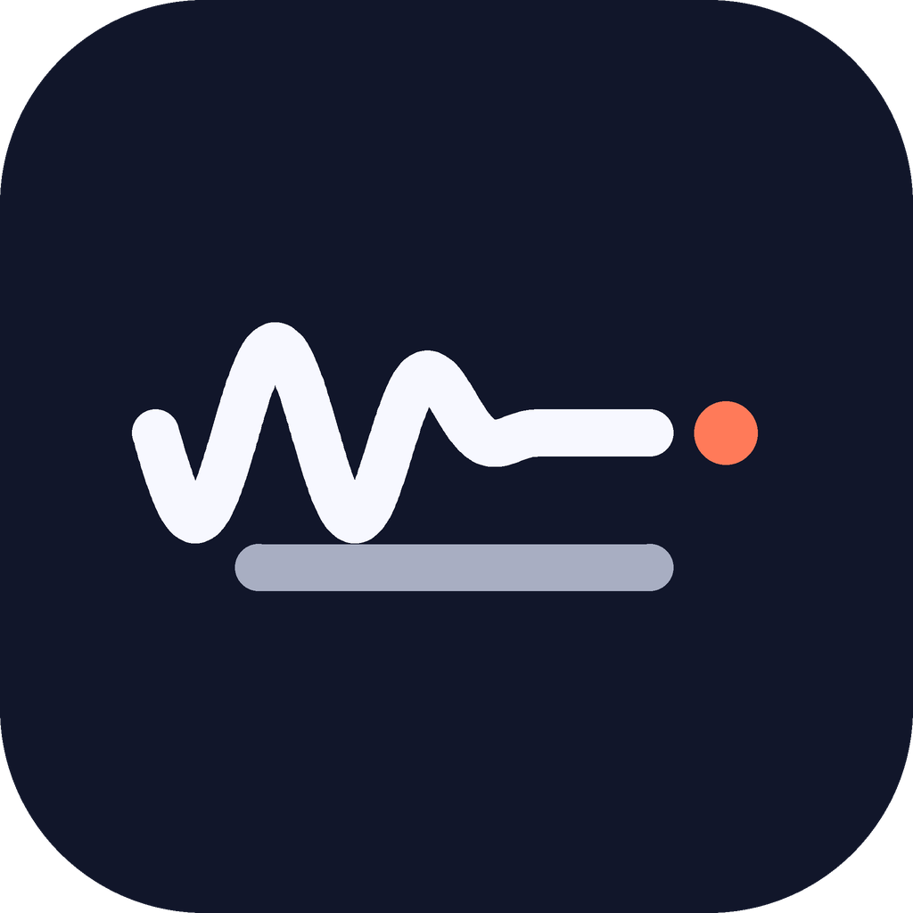
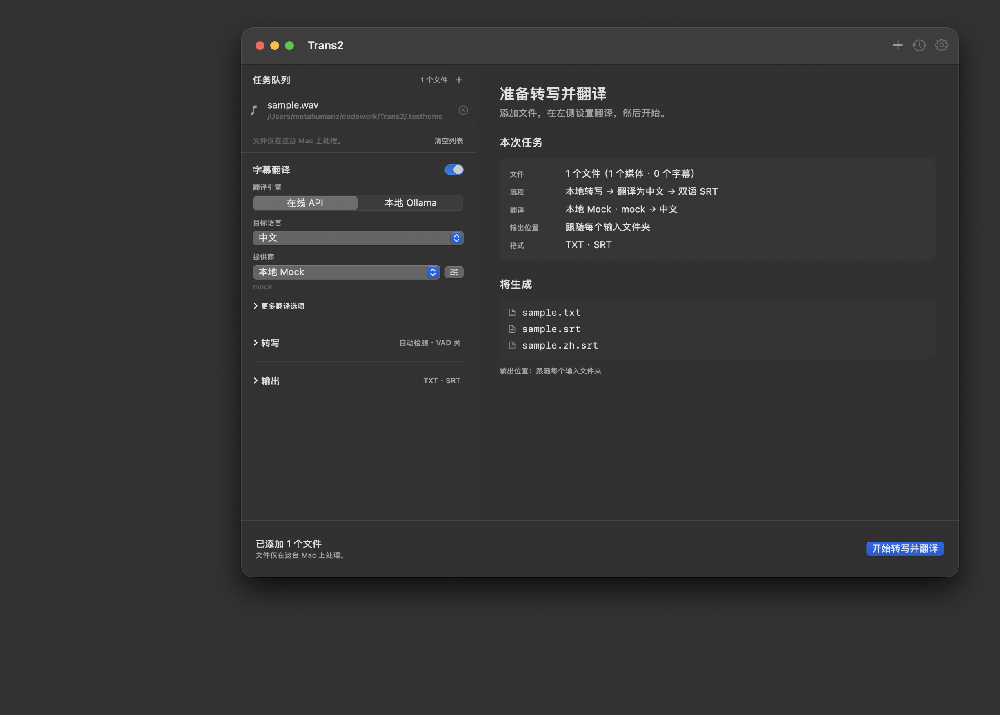
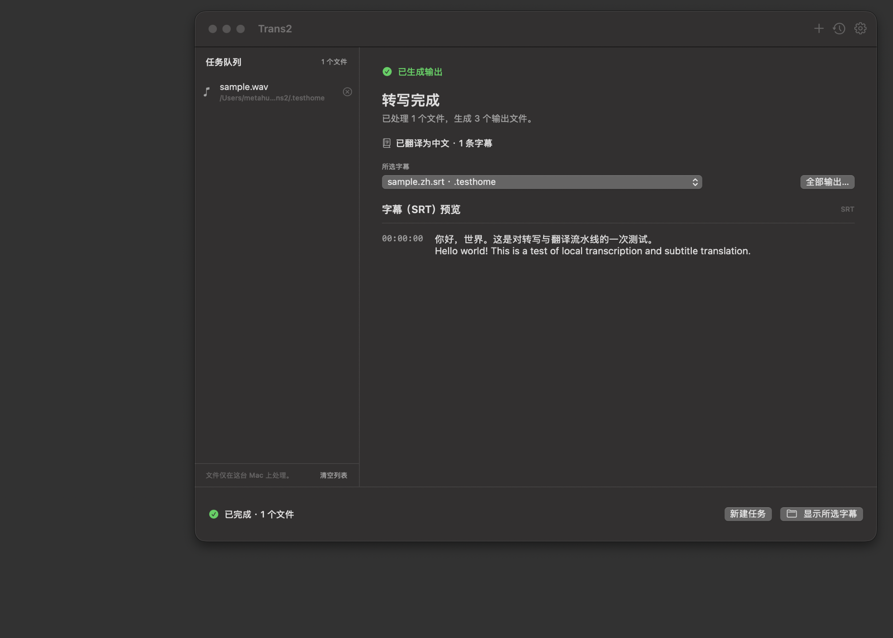
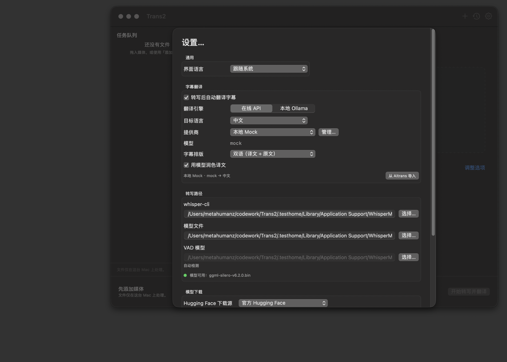
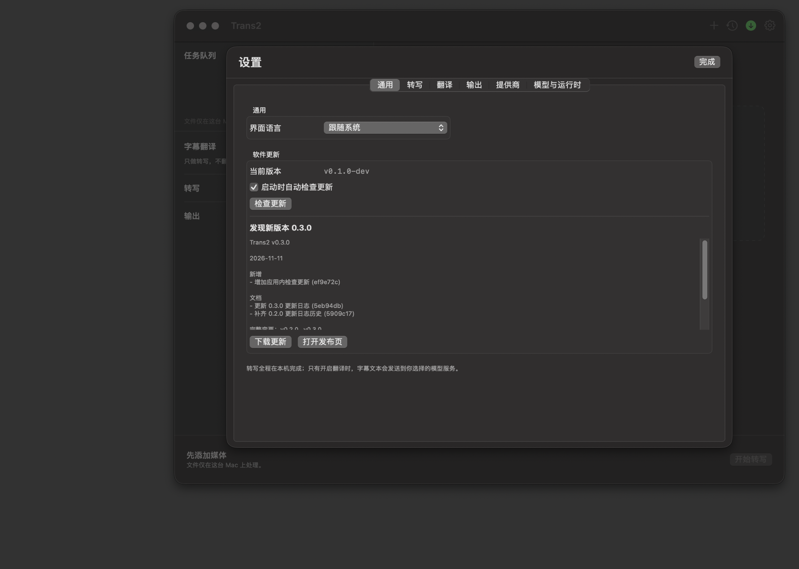

#  Trans2

**本地转写 + AI 字幕翻译，一个 Mac 应用。**

Trans2 把 [WhisperMac](https://github.com/sxsxsx-git/whispermac) 的本地
whisper.cpp 转写能力和 [AItrans](../AItrans) 的字幕翻译内核合成一条流水线：

```
音视频 ──afconvert──▶ whisper.cpp ──▶ SRT ──▶ OpenAI 兼容 API / Ollama ──▶ 双语 SRT
                                          ▲
                                  已有 .srt 直接进入翻译
```

文件不离开本机完成转写；只有翻译这一步会把字幕文本发给你选择的模型服务。

[最新发布](https://github.com/Metahumanz/Trans2/releases) · [更新日志](CHANGELOG.md)

## 界面

窗口按操作顺序分成三块：

- **左侧任务轨**：队列在上，常用任务设置在下（翻译开关、目标语言、提供商、翻译时机）；转写和输出的详细设置用摘要行进入设置页签；
- **中间工作区**：拖入文件后显示「本次任务」和「将生成」的文件清单；运行时显示实时字幕；结束后显示 SRT 预览和全部输出文件；
- **设置窗口**：按「通用 / 转写 / 翻译 / 输出 / 提供商 / 模型与运行时」分成页签，路径、提供商、并发等一次性配置都收在这里；
- **底部动作栏**：状态 + 开始 / 停止 / 新建任务。





## 功能

- **一条队列，两种输入**：音视频走「转写 → 翻译」，`.srt` 直接走「翻译」，也可以混在一起。
- **本地转写**：whisper.cpp + Metal，可选 Core ML / ANE encoder；批量、实时文本、VAD、TXT/SRT/VTT/JSON 导出都继承自 WhisperMac。
- **AI 翻译**：任意 OpenAI 兼容接口或本地 Ollama；目标语言中文 / 英文 / 日文 / 韩文；可开关「模型润色」。
- **两种翻译时机**：可以等全部转写完成后统一翻译，也可以「边转写边翻译」——每完成一个文件就开始翻译，同时继续转写下一个；批量处理时明显缩短总耗时。
- **双语字幕**：默认输出「译文在上、原文在下」的 `xxx.<lang>.srt`，也可以只输出译文。
- **提供商管理**：9 个预设、增删改、切换、连通性测试；密钥保存在本机 `secrets.json`（0600），不进 `providers.json`。
- **从 AItrans 一键导入**：首次启动自动读取 `~/Library/Application Support/AITrans/` 里的提供商与密钥，不用重填 Key。
- **应用内检查更新**：启动时可选自动检查 GitHub Releases；发现新版本可下载 dmg/zip 或打开发布页。仓库公开，无需任何 Token。
- **沿用 WhisperMac 的运行时**：首次启动会优先复用 `~/Library/Application Support/WhisperMac/` 里已有的 whisper-cli、模型、Core ML encoder 和 Silero VAD 模型，不重复下载 1.5 GB。
- **界面**：English / 简体中文 / 日本語，跟随系统或手动切换。





## 系统要求

- Apple Silicon Mac（Intel 不在目标内）
- macOS 14 或更高
- 一个 whisper.cpp 模型（如 `ggml-large-v3-turbo.bin`）；应用内可下载，或复用 WhisperMac 已有的模型

## 构建

```sh
# 一次性准备 whisper.cpp 运行时（Metal + CoreML）
brew install cmake python@3.11
./Scripts/setup-whispercpp.sh

# 跑测试
swift test --disable-sandbox

# 产出 dist/Trans2.app、zip 与 dmg
./Scripts/package-app.sh 0.1.0
```

日常调试用 `./make-app.sh` 生成仓库根目录的 `Trans2.app`；直接 `swift run`
也可以，但资源包与运行时路径以 `.app` 为准。

> 本机 SwiftPM 的 sandbox 在部分环境不可用，脚本统一加了 `--disable-sandbox`。

## 使用

1. 拖入音视频或 `.srt` 文件（可拖文件夹，递归扫描）。
2. 在左侧「字幕翻译」里打开开关，选目标语言、提供商和翻译时机；点提供商右侧的按钮可以管理接口、模型和 API Key，或从 AItrans 导入。
   - 「全部转写完成后」适合想先检查转写再翻译的流程；
   - 「边转写边翻译」适合批量任务，转完一个文件就开始翻译；
   - 展开「更多翻译选项」可切换双语 / 仅译文、是否润色；
   - 「转写」「输出」的详细设置在设置窗口对应页签里。
3. 点右下角「开始转写并翻译」。

产物默认写在源文件旁边：

| 输入 | 产物 |
| --- | --- |
| `movie.mp4` | `movie.txt`、`movie.srt`、`movie.zh.srt` |
| `existing.srt` | `existing.zh.srt`（若设置了统一输出目录则写到那里） |

- `movie.srt` 是 whisper 原文，`movie.zh.srt` 是译文（默认双语）。
- 翻译失败不会丢掉转写结果：失败会写进日志，结果页会提示失败段数。
- 只放 `.srt` 时不需要 whisper-cli 或模型。

## 数据位置

| 内容 | 路径 |
| --- | --- |
| 提供商 / 翻译设置 | `~/Library/Application Support/Trans2/providers.json`、`settings.json` |
| API Key | `~/Library/Application Support/Trans2/secrets.json`（明文，0600） |
| 下载的模型 / encoder | `~/Library/Application Support/Trans2/runtime/` |
| 运行日志（含字幕内容） | `~/Library/Logs/Trans2/` |
| 转写历史 | `~/Library/Application Support/Trans2/history.json` |

## 结构

```
Trans2/
├─ Sources/TransCore/     翻译内核（SRT、提示词、提供商、重试、润色）
│  └─ Generated/Spec.swift  由 spec/ 生成，勿手改
├─ Sources/Trans2/        SwiftUI 应用 + 转写流水线 + 翻译阶段
├─ Tests/TransCoreTests/  翻译内核单测（含 AItrans 黄金样本）
├─ Tests/Trans2Tests/     应用、路径、队列、端到端测试
├─ spec/                  提示词与预设的唯一事实来源
├─ tools/gen_spec.py      从 spec/ 生成 TransCore/Generated/Spec.swift
├─ tools/gen_icon.py      生成应用图标（docs/icon.png 与 AppIcon.icns）
├─ fixtures/              来自 AItrans 的 SRT 编码 / 解析黄金样本
├─ .github/workflows/     tag 触发的打包与 Release 流程
├─ CHANGELOG.md           已发布版本的更新日志
└─ Scripts/               打包、changelog 与 whisper.cpp 构建脚本
```

### 端到端测试

默认跳过，需要真实模型和一个本地 OpenAI 兼容 mock：

```sh
python3 Scripts/mock-openai-server.py &   # 127.0.0.1:8765
TRANS2_E2E=1 swift test --disable-sandbox --filter AppModelPipelineTests
```

覆盖：真实 `say` 语音 → `afconvert` → `whisper-cli` → 翻译 HTTP → 双语 SRT → 预览；
以及纯 `.srt` 队列跳过 whisper、写入统一输出目录。

## 发布与更新日志

版本号写在 [VERSION](VERSION)。推送 `v*` tag 会触发
[.github/workflows/release.yml](.github/workflows/release.yml)：

```sh
# 先确认 VERSION 与 tag 一致
git tag v0.1.0
git push origin main --tags
```

工作流会：

1. 在 Apple Silicon macOS runner 上跑 `swift test`；
2. 构建 whisper.cpp 运行时，打包 `Trans2.app`、zip 和 dmg；
3. 用 [Scripts/changelog.py](Scripts/changelog.py) 按 conventional commits 生成更新日志；
4. 创建 GitHub Release，上传 dmg / zip，并附带安装说明。

也可以在 Actions 页面手动 `workflow_dispatch`，输入版本号（必须与 `VERSION` 一致）。
仓库里的 [CHANGELOG.md](CHANGELOG.md) 记录已发布版本。

应用内「检查更新」读取的是 GitHub 的 latest release；发版后客户端就能看到新版本。

## 已知限制

- 仅 macOS / Apple Silicon；Windows 版本尚未开始。
- 不是字幕编辑器：没有时间轴拖动、逐句校对界面。
- 发布产物为 ad-hoc 签名，首次打开需右键「打开」或 `xattr -cr`。
- 应用内更新检查依赖 GitHub Releases 的公开 API。
- 翻译会消耗所选服务的额度；密钥以明文保存在本机文件，请自行保护用户目录。
- 同一次批量里若两个同名 `.srt` 指向同一个统一输出目录，后一个会覆盖前一个。

## 来源与许可

- 转写壳与 whisper.cpp 集成来自 **WhisperMac**（MIT）。
- 翻译提示词、提供商存储与润色流水线来自作者自己的 **AItrans**。
- whisper.cpp 为 MIT；Silero VAD 模型按需下载。
- 本项目未声明开源许可。

第三方声明见 [THIRD_PARTY_NOTICES.md](THIRD_PARTY_NOTICES.md)。
